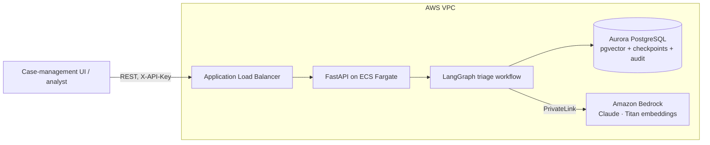
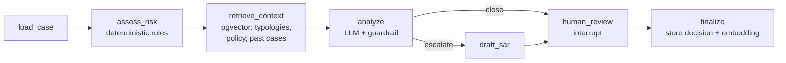

# AML Alert Triage Agent

An AI agent that investigates transaction-monitoring alerts. It pulls the customer and 90 days of transactions, runs deterministic risk rules, retrieves matching typologies, policy and past analyst decisions from a vector database, and asks an LLM for a disposition. For escalations it drafts a SAR narrative. Every case then waits for a human analyst to approve or override.

**Stack:** Python 3.12 · LangGraph · FastAPI · PostgreSQL + pgvector · Amazon Bedrock (Claude + Titan embeddings) · Terraform (ECS Fargate, Aurora Serverless v2, ALB, Secrets Manager).

## Architecture



### The agent graph



Design choices that matter for a compliance buyer:

- **Rules before the model.** Structuring, rapid pass-through, high-risk jurisdictions, profile deviation, round amounts, PEP and customer risk are computed in plain Python (`app/rules.py`). The LLM reasons over evidence that is reproducible and cites transaction IDs.
- **Guardrail over the model.** If the rule score is at or above `FORCE_ESCALATE_SCORE` and the model says "close", the case is escalated anyway and flagged `guardrail_override`.
- **Human in the loop.** The graph pauses with a LangGraph `interrupt()` and state is checkpointed in Postgres, so a review can happen hours later on a different container. Overrides require a comment.
- **Institutional memory.** Each reviewed decision is embedded and stored; later cases retrieve the most similar past decisions and the analyst's rationale.
- **Audit trail.** Every node writes to `audit_log` (`GET /alerts/{id}/audit`).
- **Data stays in your AWS account.** Bedrock is reached through a VPC endpoint; no third-party LLM API.

## Run it locally (no AWS needed)

With Docker:

```bash
docker compose up -d --build
docker compose exec api python -m scripts.seed      # schema, knowledge base, 3 demo alerts
open http://localhost:8000/docs                      # Swagger UI
```

Without Docker (needs Postgres 16 with pgvector):

```bash
python -m venv .venv && source .venv/bin/activate
pip install -r requirements-dev.txt
cp .env.example .env          # mock LLM + local embeddings by default
python -m scripts.seed --reset
uvicorn app.api:app --reload
```

Local mode uses a deterministic mock analyst and a hashing embedder so you can exercise the whole flow offline. Retrieval quality in this mode is rough; switch to Bedrock for real semantic search.

### Walkthrough

```bash
# 1. Triage an alert -> runs the graph until it pauses for review
curl -s -X POST localhost:8000/alerts/A-1002/triage | jq '{thread_id, status, decision, sar_narrative}'

# 2. Analyst approves (or {"decision":"override","disposition":"close", ...})
curl -s -X POST localhost:8000/cases/<thread_id>/review \
  -H 'Content-Type: application/json' \
  -d '{"decision":"approve","analyst":"jdoe","comment":"Pass-through to high-risk jurisdiction; refer to FIU."}'

# 3. Audit trail
curl -s localhost:8000/alerts/A-1002/audit | jq
```

Demo alerts: **A-1001** cash structuring then a wire out (escalate), **A-1002** foreign wire forwarded to a high-risk jurisdiction within 48 hours (escalate), **A-1003** a large but legitimate insurer reconciliation to a dental practice (close).

### API

| Method | Path | Purpose |
|---|---|---|
| GET | `/health` | Liveness + DB check |
| GET | `/alerts?status=open` | List alerts |
| POST | `/alerts/{alert_id}/triage` | Run the agent; returns case with `thread_id` |
| GET | `/cases/{thread_id}` | Current case state, pending review payload |
| POST | `/cases/{thread_id}/review` | Analyst approve / override (resumes the graph) |
| GET | `/alerts/{alert_id}/audit` | Step-by-step audit log |
| POST | `/knowledge` | Add a typology / policy / regulation doc (markdown, chunked on `##`) |

Set `API_KEY` to require an `X-API-Key` header on all endpoints except `/health`.

### Using Bedrock locally

Enable model access for your chosen Claude model and `amazon.titan-embed-text-v2:0` in the Bedrock console, then:

```bash
export LLM_PROVIDER=bedrock EMBEDDING_PROVIDER=bedrock AWS_REGION=us-east-1 AWS_PROFILE=your-profile
export BEDROCK_MODEL_ID=<model or inference-profile id from the Bedrock console>
python -m scripts.seed --reset   # re-embed the knowledge base with Titan
```

Changing embedding provider or dimension means re-seeding, since vectors from different models are not comparable.

## Deploy to AWS

Prerequisites: Terraform ≥ 1.6 (or OpenTofu), AWS CLI, Docker, Bedrock model access enabled in the target region.

```bash
cd infra/terraform
cp example.tfvars dev.tfvars            # set allowed_ingress_cidrs, certificate_arn, model id
terraform init
terraform apply -var-file=dev.tfvars    # VPC, Aurora, ECR, ECS, ALB, secrets (~15 min)

# Build and push the image
ECR=$(terraform output -raw ecr_repository_url)
aws ecr get-login-password | docker login --username AWS --password-stdin ${ECR%/*}
docker build --platform linux/amd64 -t $ECR:latest ../..
docker push $ECR:latest
aws ecs update-service --cluster $(terraform output -raw ecs_cluster) --service api --force-new-deployment

# Seed schema + knowledge base (+ demo data) with a one-off task
eval "$(terraform output -raw seed_command)"

# Call it
KEY=$(aws secretsmanager get-secret-value --secret-id $(terraform output -raw api_key_secret_arn) --query SecretString --output text)
curl -H "X-API-Key: $KEY" $(terraform output -raw api_url)/alerts
```

What gets created: VPC across 2 AZs (public, private and database subnets, one NAT), Aurora PostgreSQL Serverless v2 (encrypted, master password managed in Secrets Manager), ECR with scan-on-push, ECS Fargate service in private subnets behind an ALB (HTTPS when you pass a certificate), Bedrock PrivateLink endpoint, least-privilege task role limited to `bedrock:InvokeModel*`, CloudWatch logs with 90-day retention.

## Configuration

| Variable | Default | Notes |
|---|---|---|
| `DATABASE_URL` | — | Or `DB_HOST`/`DB_USER`/`DB_PASSWORD`/`DB_NAME` (used on AWS) |
| `LLM_PROVIDER` | `bedrock` | `mock` for offline |
| `EMBEDDING_PROVIDER` | `bedrock` | `local` for offline |
| `BEDROCK_MODEL_ID` | Claude Sonnet inference profile | Check the ID available in your region |
| `EMBEDDING_DIM` | `1024` | Must match the vector columns; re-seed if changed |
| `HISTORY_DAYS` | `90` | Transaction lookback |
| `FORCE_ESCALATE_SCORE` | `70` | Rule score that overrides a model "close" |
| `AUTO_CLOSE_MAX_SCORE` | `-1` | `-1` = every case needs a human |
| `HIGH_RISK_COUNTRIES` | `KP,IR,MM` | Keep aligned with your compliance policy and FATF updates |
| `STRUCTURING_THRESHOLD` | `10000` | Reporting threshold for the structuring rule |

## Project layout

```
app/
  api.py         FastAPI endpoints
  graph.py       LangGraph workflow, guardrail, human-review interrupt
  rules.py       deterministic risk signals
  analyst.py     Bedrock analyst (structured output) + offline mock, prompts
  knowledge.py   embeddings, chunking, pgvector search
  db.py          schema, pools, queries, audit log
  config.py      settings
scripts/seed.py  schema + knowledge base + synthetic demo data
data/knowledge/  typology and policy markdown (edit / add your own)
tests/           rules unit tests + end-to-end API tests on real Postgres
infra/terraform/ AWS infrastructure
```

## Before this touches real customer data

This is an MVP. Things to add before production:

- **Auth:** replace the shared API key with Cognito / your IdP (JWT) and per-analyst identity, so `analyst` comes from the token, not the request body.
- **Async triage:** LLM calls take 10–60s. Move `/triage` onto a queue (SQS + worker) and have the client poll `/cases/{id}`.
- **DB credentials:** the RDS-managed secret rotates every 7 days; either redeploy tasks on rotation or switch to IAM database authentication.
- **Sanctions screening:** integrate a screening provider; a confirmed hit should bypass this workflow.
- **Model risk management:** evaluate the analyst on a labelled set of historical alerts (precision/recall of escalations, narrative quality), log prompts and outputs for validation, and version prompts.
- **Data protection:** PII redaction in logs, KMS customer-managed keys, Bedrock guardrails, WAF on the ALB, private ALB behind VPN if only internal users need it.
- **Terraform state** in S3 with locking (the backend block is ready to uncomment).
